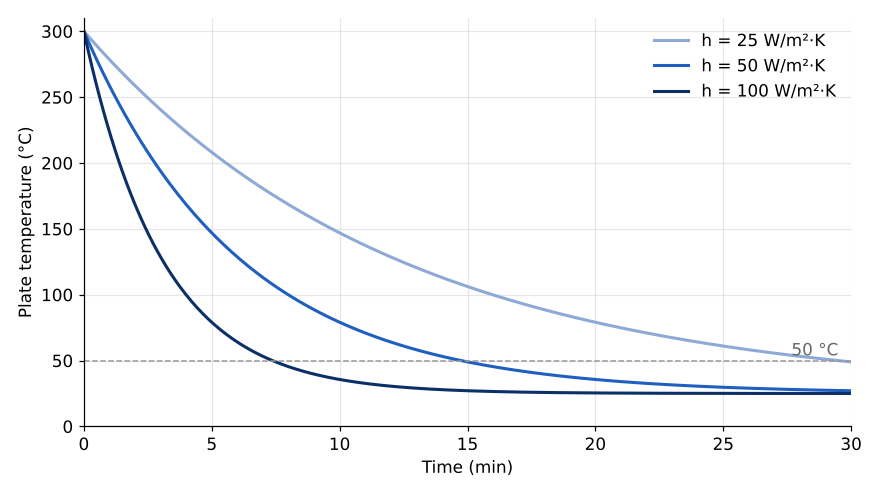

## Overview

> **This is a sample.** It exists to show what a project page looks like and which Markdown features the portfolio renders. Replace it with a real project.

A 10 mm steel plate leaves a furnace at 300 °C and cools in still air at 25 °C. The goal was to predict how long it takes to reach a safe handling temperature of 50 °C, and to check whether a simple lumped-capacitance model is good enough.

## Problem

- Plate thickness $L = 10\ \text{mm}$, cooled on both faces
- Steel: $\rho = 7850\ \text{kg/m}^3$, $c = 470\ \text{J/kg·K}$, $k = 45\ \text{W/m·K}$
- Convection coefficient $h = 50\ \text{W/m}^2\text{·K}$, ambient $T_\infty = 25\ °\text{C}$

## Approach

The lumped model assumes the plate has a uniform temperature at every instant. That is valid when the Biot number is small:

$$
Bi = \frac{h L_c}{k}, \qquad L_c = \frac{V}{A} = \frac{L}{2}
$$

With $Bi < 0.1$ the temperature follows

$$
\frac{T(t) - T_\infty}{T_i - T_\infty} = \exp\!\left(-\frac{t}{\tau}\right), \qquad \tau = \frac{\rho c L_c}{h}
$$

The calculation itself is a few lines of Python:

```python
import numpy as np
rho, c, k, L, h = 7850, 470, 45, 0.010, 50
Lc  = L / 2
Bi  = h * Lc / k                    # 0.0056
tau = rho * c * Lc / h              # 368.9 s
t50 = tau * np.log((300 - 25) / (50 - 25))   # 884.7 s
```

## Results



| Convection coefficient | Biot number | Time constant τ | Time to 50 °C |
|---|---|---|---|
| 25 W/m²·K | 0.0028 | 738 s | 1769 s |
| 50 W/m²·K | 0.0056 | 369 s | 885 s |
| 100 W/m²·K | 0.0111 | 184 s | 442 s |

Doubling $h$ halves the cooling time, as expected from $\tau \propto 1/h$.

## Validation

1. Checked $Bi < 0.1$ across the whole range of $h$ (see the gallery).
2. Confirmed the units of $\tau$ reduce to seconds.
3. *In a real project:* compare against a transient FE model or measurements here.

## What I learned

- When a one-line analytic model is enough, and how to prove it with the Biot number
- Presenting a result as a design rule (time to safe handling) rather than just a curve

## References

1. Incropera, F. P. et al., *Fundamentals of Heat and Mass Transfer*, 7th ed., Wiley.
