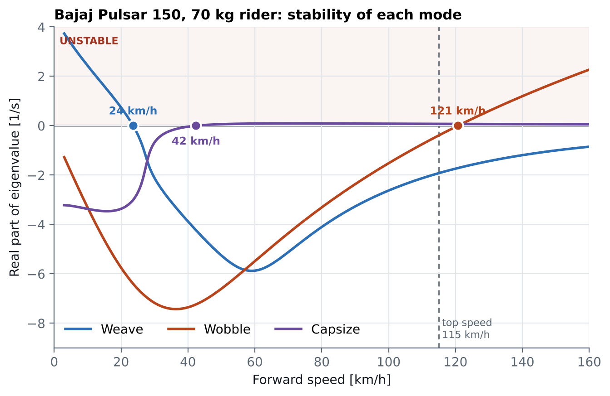
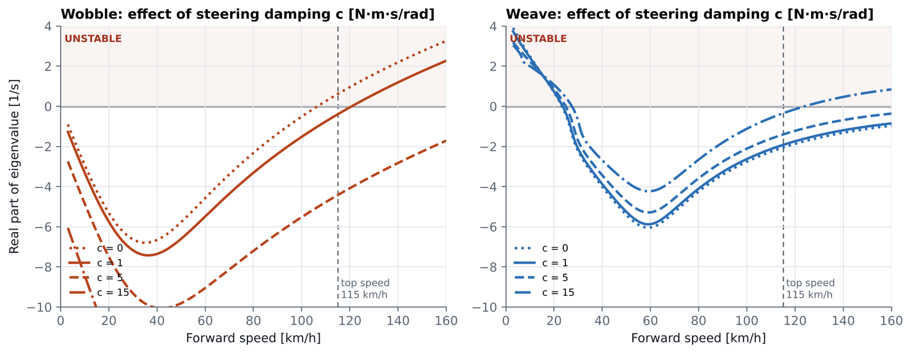

## Overview

A motorcycle balances itself only inside a band of speeds. Below it the bike falls over unless the rider steers; above it the handlebar can start to shake on its own. I built a linear stability model of a Bajaj Pulsar 150, a common Indian 150 cc commuter, to find that band and what sets each end of it. With a 70 kg rider the bike is self-stable from **24 to 121 km/h**. The upper limit is only 5.7 km/h above its 115 km/h top speed, and the tyres' relaxation length is the input that moves it most.

## Problem

- **Vehicle:** Bajaj Pulsar 150 (single disc), kerb mass 148 kg, wheelbase 1320 mm, tyres 80/100-17 front and 100/90-17 rear, top speed about 115 km/h. These are the only published inputs.
- **Rider:** 70 kg, seated upright, rigidly attached to the frame with hands off the bar.
- **Operating condition:** straight running at constant speed on a flat road, 3 to 160 km/h.
- **Question:** which natural motions (modes) grow or decay at each speed, and how do steering damping, tyre lag, wheel gyroscopics, a pillion or a top box change that?
- **Assumptions:** small disturbances (linear analysis), rigid frame and fork, no suspension, linear tyres with a fixed relaxation length, no aerodynamics.
- **Units:** speeds in km/h, everything else SI.

Three modes matter:

- **Weave:** the whole bike sways, with roll, yaw and steer moving together. At very low speed this mode is the bike falling over.
- **Wobble:** the front assembly shakes about the steering axis at 6–9 Hz while the frame barely moves.
- **Capsize:** a slow, non-oscillating lean into a tightening turn.

## Approach

**Model.** Four rigid bodies: rear frame with rider, rear wheel, front frame (fork, clamps, handlebar, headlamp) and front wheel, the layout of Sharp (1971) and Meijaard et al. (2007). It is a lumped-parameter model with four degrees of freedom (lateral motion, yaw, roll $\phi$ and steer $\delta$) plus the two tyre side forces, giving eight states: roll, steer, lateral velocity of the rear contact, yaw rate, roll rate, steer rate and the two tyre forces. Yaw angle does not appear in the equations, so it drops out.

**Tyres.** Each tyre's side force follows its slip angle $\alpha$ and camber angle $\gamma$ with a first-order lag set by the relaxation length $\sigma$:

$$\frac{\sigma}{v}\,\dot{Y} + Y = -C_\alpha\,\alpha + C_\gamma\,\gamma$$

Cornering and camber stiffness scale with static wheel load, $C_\alpha = k_\alpha N$ and $C_\gamma = k_\gamma N$.

**Equations of motion.** Kane's method, the virtual-power form of the Lagrange–d'Alembert principle. For each generalised speed $u_r$:

$$F_r + F_r^{*} = 0, \qquad F_r^{*} = -\sum_i \left( m_i\,\mathbf{a}_i \cdot \frac{\partial \mathbf{v}_i}{\partial u_r} + \left( \mathbf{I}_i \boldsymbol{\alpha}_i + \boldsymbol{\omega}_i \times \mathbf{I}_i \boldsymbol{\omega}_i \right) \cdot \frac{\partial \boldsymbol{\omega}_i}{\partial u_r} \right)$$

It is equivalent to Lagrange's equations here but handles the lateral velocity and yaw rate, which are measured in a moving frame, without extra terms. Each wheel spins at $v/r$, and the $\boldsymbol{\omega} \times \mathbf{I}\boldsymbol{\omega}$ term carries the gyroscopic moments.

**Linearisation.** No equation is derived by hand. The code builds every velocity from rigid-body kinematics, forms the residual numerically and differentiates it about upright straight running by the complex-step method, which is exact to machine precision:

$$\frac{\partial f}{\partial x} \approx \frac{\operatorname{Im} f(x + i h)}{h}, \qquad h = 10^{-30}$$

The result is $\dot{x} = A(v)\,x$. Its matrices are either constant, linear in $v$ or proportional to $1/v$, so two evaluations give $A(v)$ at every speed exactly.

**Reading the eigenvalues.** Each eigenvalue $\lambda = \sigma_r \pm j\omega$ is one mode. A negative real part means a disturbance decays, positive means it grows. The frequency is $\omega/2\pi$ and the damping ratio is $\zeta = -\sigma_r/|\lambda|$.

**Mode tracking.** Branches cross as speed changes, so sorting eigenvalues by size mixes modes up. Each eigenvalue is followed from one speed step to the next by an optimal assignment on eigenvalue distance plus eigenvector dissimilarity (1 − MAC). Modes are named once at 60 km/h from their frequency and steer content.

**Tools.** Python with NumPy, SciPy (`linear_sum_assignment`) and Matplotlib. The whole study runs from one script in about 20 seconds. I also wrote a line-for-line MATLAB port of the model; it has not yet been run in MATLAB.

## Setup

Only kerb mass, wheelbase and tyre sizes are published. Every other input was derived from those, taken from the literature or estimated, and every estimate is covered by the sensitivity study.

| Parameter | Baseline | Range tested | Basis |
|---|---|---|---|
| Kerb mass | 148 kg | – | Published (Bajaj Auto) |
| Wheelbase | 1320 mm | – | Published |
| Tyre radii | 296 mm front, 306 mm rear | – | Derived from ISO tyre sizes |
| Rake | 26° | 24–28° | Estimated |
| Mechanical trail | 100 mm | 80–120 mm | Estimated |
| Rider mass | 70 kg | 55–90 kg | Estimated |
| Normalised cornering stiffness $k_\alpha$ | 11.1 /rad | 8–15 /rad | Sharp (1971) |
| Normalised camber stiffness $k_\gamma$ | 0.93 /rad | 0.7–1.2 /rad | Sharp (1971) |
| Relaxation length $\sigma$ | 0.20 m | 0.10–0.30 m | Estimated (Pacejka 2012 range) |
| Steering damping | 1.0 N·m·s/rad | 0–3 (study 0–20) | Estimated; no damper fitted |
| Front frame inertia | built from fork, clamps, bar, headlamp | ×0.75–1.25 | Estimated |
| Rear-frame CG height | 500 mm | ±50 mm | Estimated |

Derived whole-vehicle values: mass 218 kg, 43.9% of the load on the front wheel, CG 684 mm high, steer-axis inertia of the front assembly 0.618 kg·m², wheel spin inertia 0.377 kg·m² front and 0.473 kg·m² rear. Cornering stiffness comes out at 10,424 N/rad front and 13,314 N/rad rear.

## Results

| Speed [km/h] | Capsize Re [1/s] | Weave Re [1/s] | Weave [Hz] | Weave ζ | Wobble Re [1/s] | Wobble [Hz] | Wobble ζ |
|---|---|---|---|---|---|---|---|
| 10 | −3.37 | +2.43 | 0.27 | −0.82 | −3.31 | 8.57 | 0.061 |
| 20 | −3.37 | +0.74 | 0.33 | −0.33 | −5.75 | 8.30 | 0.110 |
| 30 | −0.68 | −2.12 | 0.44 | 0.61 | −7.18 | 7.92 | 0.143 |
| 60 | +0.09 | −5.87 | 1.62 | 0.50 | −5.49 | 6.97 | 0.124 |
| 100 | +0.08 | −2.63 | 2.52 | 0.16 | −1.52 | 6.71 | 0.036 |
| 115 | +0.07 | −1.92 | 2.64 | 0.12 | −0.39 | 6.71 | 0.009 |
| 130 | +0.07 | −1.43 | 2.73 | 0.08 | +0.60 | 6.73 | −0.014 |

- **Weave** grows below 23.6 km/h. At 10 km/h an uncorrected lean doubles in about 0.3 s, which is why a rider steers constantly in slow traffic. It is best damped near 60 km/h ($\zeta$ = 0.50) and falls to 0.12 at top speed.
- **Wobble** is strongly damped at low speed, loses damping steadily and crosses zero at 120.7 km/h. Its frequency, 8.6 Hz falling to 6.7 Hz, sits in the 7–10 Hz band reported in the literature.
- **Capsize** turns unstable at 42.4 km/h but peaks at only +0.093 /s, a doubling time of about 7.5 s, which a rider corrects without noticing.

**Steering damping has an optimum.** The Pulsar has no steering damper, only bearing, seal and arm damping. With none at all, wobble would go unstable at 106.5 km/h, below top speed. More damping raises the wobble limit but also resists the self-correcting steer that keeps weave in check.

| Steering damping [N·m·s/rad] | Wobble unstable above [km/h] | Weave unstable above [km/h] | Weave ζ at 115 km/h |
|---|---|---|---|
| 0 | 106.5 | stable to 250 | 0.123 |
| 1 (baseline) | 120.7 | stable to 250 | 0.115 |
| 3 | 154.6 | stable to 250 | 0.100 |
| 5 | 195.9 | stable to 250 | 0.085 |
| 7.5 | stable to 250 | 164.0 | 0.067 |
| 20 | stable to 250 | 114.6 | −0.001 |

**Tyre lag is what makes wobble possible.** With instantaneous tyre forces ($\sigma = 0$) wobble never goes unstable. Over the plausible range of relaxation length the wobble limit moves from 156 to 70 km/h, while weave does not move at all (23.6–23.7 km/h).

, and the wobble limit against relaxation length (right).")

**The gyroscope both balances the bike and helps it shake.** Removing wheel spin from the inertia terms, with everything else unchanged, leaves the bike unstable at every speed (+1.69 /s at 20 km/h, +0.30 /s at 100 km/h), but wobble then decays at −4.70 /s at top speed instead of −0.39 /s and never goes unstable up to 160 km/h.

 and wobble (right), with and without wheel spin.")

**Loading.** A 65 kg pillion raises the wobble limit to 135.3 km/h, or 126.4 km/h if tyre stiffness is held at solo values, so it does not reduce the margin. A 15 kg top box behind the rear axle lowers the limit to 115.1 km/h, the bike's top speed, and takes wobble damping at 115 km/h to zero.

> The low-speed end of the band is a firm prediction; the high-speed end should be read as "close to top speed", because it depends most on tyre properties nobody has published for this bike.

## Validation

With very stiff tyres ($C_\alpha = 10^9$ N/rad, no lag) the model becomes the non-slipping Carvallo–Whipple bicycle, for which Meijaard et al. (2007) published benchmark results. Run with their parameters unchanged:

| Check | Published | This model |
|---|---|---|
| Eigenvalues at 2, 5 and 8 m/s | 12 values to 3 decimals | identical to 3 decimals |
| Weave speed | 4.292383 m/s | 4.292383 m/s |
| Capsize speed | 6.024262 m/s | 6.024258 m/s |

 against the published benchmark values (circles), 0 to 10 m/s.")

The small capsize difference comes from approaching the rigid-tyre limit with a finite stiffness; it shrinks tenfold for each tenfold increase in $C_\alpha$. The Pulsar results also match published trends. Sharp (1971) found weave unstable below about 22 km/h and capsize mildly unstable above about 38 km/h on his machine, and the wobble frequency agrees with the 7–10 Hz band in Cossalter et al. (2002) and Passigato et al. (2020).

A one-at-a-time sensitivity study bounds the estimated inputs. Every input over its full range keeps weave stabilisation between 22.9 and 24.3 km/h. The wobble limit is far less certain: relaxation length alone moves it by 86 km/h.

 and weave stabilisation speed (right) with each estimated input at the ends of its range.")

## What I learned

- **Validate the mechanics before trusting any vehicle number.** My first version of this model labelled the low-speed instability as capsize and had a sign error in the tyre lag equations that left three eigenvalues positive at every speed. Matching a published benchmark to six significant figures caught both; the low-speed fall is the weave mode.
- **Numerical linearisation is a practical alternative to deriving equations by hand.** Complex-step differentiation of a kinematics-based residual gave exact Jacobians and removed the main source of algebra mistakes.
- **Eigenvalues need tracking, not sorting.** Following each mode by eigenvector similarity was what made the speed sweeps readable, especially near 27 km/h where the weave and capsize branches approach each other and exchange character.
- **Sensitivity studies say which conclusions to trust.** Weave near 24 km/h is robust; the wobble limit depends on tyre data that would need measuring.

## References

1. Sharp, R.S. (1971). The stability and control of motorcycles. *Journal of Mechanical Engineering Science*, 13(5), 316–329.
2. Meijaard, J.P., Papadopoulos, J.M., Ruina, A. and Schwab, A.L. (2007). Linearized dynamics equations for the balance and steer of a bicycle: a benchmark and review. *Proceedings of the Royal Society A*, 463(2084), 1955–1982. [doi:10.1098/rspa.2007.1857](https://doi.org/10.1098/rspa.2007.1857)
3. Pacejka, H.B. (2012). *Tire and Vehicle Dynamics*, 3rd edition. Butterworth-Heinemann.
4. Kane, T.R. and Levinson, D.A. (1985). *Dynamics: Theory and Applications*. McGraw-Hill.
5. Martins, J.R.R.A., Sturdza, P. and Alonso, J.J. (2003). The complex-step derivative approximation. *ACM Transactions on Mathematical Software*, 29(3), 245–262. [doi:10.1145/838250.838251](https://doi.org/10.1145/838250.838251)
6. Cossalter, V., Doria, A., Basso, R. and Fabris, D. (2002). Experimental analysis of out-of-plane structural vibrations of two-wheeled vehicles. *Shock and Vibration*, 9, 1–8.
7. Passigato, F., Eisele, A., Wisselmann, D., Gordner, A. and Diermeyer, F. (2020). Analysis of the phenomena causing weave and wobble in two-wheelers. *Applied Sciences*, 10(19), 6826. [doi:10.3390/app10196826](https://doi.org/10.3390/app10196826)
8. Kooijman, J.D.G., Meijaard, J.P., Papadopoulos, J.M., Ruina, A. and Schwab, A.L. (2011). A bicycle can be self-stable without gyroscopic or caster effects. *Science*, 332(6027), 339–342. [doi:10.1126/science.1201959](https://doi.org/10.1126/science.1201959)
9. Karanam, V.M. and Ghosal, A. (2013). Studies on the wobble mode stability of a three-wheeled vehicle. *Proceedings of the Institution of Mechanical Engineers, Part D*, 227(8), 1200–1209.
10. Bajaj Auto. [Pulsar 150 specifications](https://www.bajajauto.com/bikes/pulsar/pulsar-150/specifications): kerb mass, wheelbase, tyre sizes.
11. Team-BHP. [Bajaj Pulsar P150 specifications](https://www.team-bhp.com/new-bikes/bajaj/pulsar-p150/specifications/): top speed.
